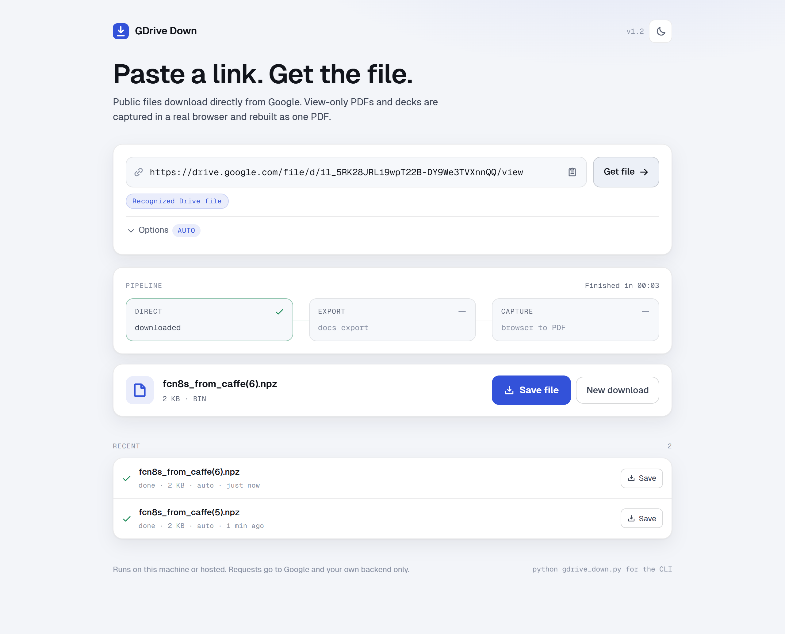

# gdrive_down

Google Drive PDF and PPT downloader with automatic capture of view-only files.

Paste a Drive link, get the file. Public files download directly from Google.
View-only PDFs and presentation decks, where the owner disabled downloading,
are captured page by page in a real browser and rebuilt as one PDF. No console
pasting, no browser extensions, no manual steps.

**Live demo:** https://gdrivedown.vercel.app



## Features

- One input: paste any Google Drive file link or file id
- Direct download for public PDF, PPT, PPTX and other files, including the
  large-file confirmation flow
- Native export for Google Docs, Slides and Sheets (PDF, PPTX, XLSX)
- Automatic capture for view-only and download-disabled documents
- Live pipeline view with byte-level and page-level progress
- Waking notice with a progress bar when the hosted free-tier backend is asleep
- Light and dark themes, mobile friendly layout
- CLI included, using the same three download strategies

## Run it

### Web app, locally (full features)

Requires Python 3.10 or newer.

1. Double-click `GDrive Down.bat` (or run `python server.py`).
2. The first launch installs Python dependencies once.
3. The app opens at http://127.0.0.1:8756.

Files land in the `downloads/` folder next to the app. Capture uses the
installed Edge or Chrome browser through Playwright.

### Web app, hosted

The repo is ready for a split deployment: UI on Vercel, backend on Render.
See Hosting below. The live demo above runs this setup.

### CLI

```text
python gdrive_down.py "https://drive.google.com/file/d/FILE_ID/view?usp=sharing"
python gdrive_down.py
```

Options: `-o OUT`, `-n NAME`, `--mode auto|direct|export|capture`, `--port N`,
`--keep-images`, `-v`, `--self-test`.

## Hosting

### UI on Vercel

Import the repository on Vercel and deploy. `vercel.json` builds `webapp` and
serves `webapp/dist`. Then set `VITE_API_BASE` in the project environment
variables to the backend URL, for example
`https://gdrive-down-api.onrender.com`, and redeploy.

### Backend on Render

1. Create an account at render.com.
2. Choose New, then Blueprint, then pick this repository and apply.
3. Render builds the Dockerfile and deploys `gdrive-down-api`.

Render free tier notes:

- The service sleeps after about 15 minutes idle. The UI shows a waking notice
  with a progress bar on the first request and starts your job automatically
  once the server answers, usually within a minute.
- 512 MB RAM: captures run one at a time and render at reduced scale. Very
  large decks may run out of memory, so run locally for those.
- Files that require a Google sign-in cannot be captured on the hosted
  backend. Use the local app for fully private files.
- The free tier includes 5 GB of bandwidth per month.

### Other backends

Point `VITE_API_BASE` at any host running `server.py`. The backend is a single
FastAPI app with no database.

## How it works

1. Direct. Downloads public files from drive.usercontent.google.com and handles
   the large-file virus scan confirmation automatically.
2. Export. Uses the docs.google.com export endpoints for native Google formats.
3. Capture. For view-only documents, a headless browser opens the Drive
   preview, scrolls through every page, collects the rendered page images and
   stitches them into a single PDF.

Accepted link shapes: `drive.google.com/file/d/<ID>/...`, `/open?id=`,
`/uc?id=`, `drive.usercontent.google.com/download?id=`,
`docs.google.com/document|presentation|spreadsheets/d/<ID>/...`, or a raw file
id.

## Repo layout

```text
gdrive_down.py    CLI downloader (direct, export and capture strategies)
server.py         FastAPI backend (jobs, WebSocket progress, capture)
webapp/           React UI (Vite). dist/ is committed for local use without Node
tests/            End-to-end checks (python tests/test_e2e.py) and a preview fixture
vercel.json       Static UI deployment config for Vercel
render.yaml       Render Blueprint for the free-tier backend
Dockerfile        Backend image (API plus Playwright Chromium)
GDrive Down.bat   One-click launcher for Windows
```

## Limitations

- Capture output is rebuilt from preview images: quality matches the on-screen
  preview and there is no text layer.
- Completely private files cannot be retrieved; capture needs the file to open
  for the viewer.
- Quota-limited files need a retry later.
- Folder links are not supported.

## Requirements

- Python 3.10 or newer for the app and CLI
- Node 18 or newer, only to rebuild the frontend
- Edge or Chrome for capture on local runs

## Fair use

Only download content you have the right to access and keep. Respect copyright
and the file owner's restrictions. Intended for personal, archival use of
material you are allowed to view.
